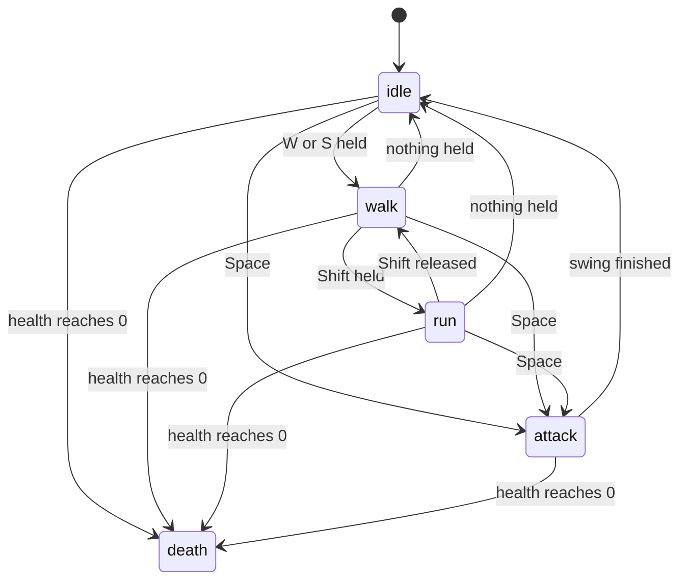

# 1. Game development basics

The handful of ideas that almost every game is built on. Each section ends with **"In this game"**,
pointing at where the idea shows up in the code.

---

## 1.1 A game is a flip-book: the game loop

A film is just still pictures shown very fast. A game is the same, except that every picture
(a **frame**) is *calculated* right before it is shown, based on what the player is doing.

The code that does this is the **game loop**. It runs roughly 60 times per second:

```
forever:
    1. look at the input       (which keys are held down?)
    2. update the world        (move the player, move monsters, apply damage, ...)
    3. draw the world          (turn the 3D world into a 2D picture on the screen)
```

The browser gives us `requestAnimationFrame(callback)`: "call `callback` right before you next repaint the
screen". Calling it again from inside the callback makes a loop that is in step with the monitor.

**In this game:** `frame()` in `src/main.js`.

## 1.2 Time between frames ("seconds elapsed")

A fast computer might draw 144 frames per second, a slow one 30. If we moved the player
"1 unit per frame", they would run 5 times faster on the fast computer!

So every update gets the **time since the previous frame**, in seconds — usually about `0.016`
(1/60 of a second). Movement is always written as *speed × time*:

```js
position.x += speed * secondsElapsed;   // same speed on every computer
```

This game also never lets one frame be longer than 1/30 of a second (`MAXIMUM_STEP_SECONDS` in `main.js`).
Browsers pause `requestAnimationFrame` while the tab is hidden; without the limit, the first frame after
coming back would see minutes pass at once and everything would jump.

## 1.3 Coordinates: x, y, z

Every point in the world is three numbers:

```
        y (up)
        |
        |
        +------ x
       /
      /
     z (the direction a character faces when its facing angle is 0)
```

The ground is the flat x–z plane at `y = 0`. The world is about 1000 × 1000 units.
One **unit** has no fixed size; the knight is 6 units tall, so one unit is about 30 cm.

In the code a position is a plain object: `{ x: 30, y: 0, z: 0 }`.

## 1.4 Directions and facing

Characters only turn left and right, so their direction is a single number: the **facing angle**, in
**radians** (a full turn is 2π ≈ 6.28; a quarter turn is π/2 ≈ 1.57).
`directionFromAngle(angle)` in `src/math.js` turns it into a direction `{ x: sin(angle), y: 0, z: cos(angle) }`,
and `angleTowards(from, to)` gives the angle to face something.

Two more tricks:

- **Distance** on the ground: `Math.hypot(a.x - b.x, a.z - b.z)` (Pythagoras).
- **"Is it in front of me?"**: multiply the matching parts of two directions and add them up
  (the **dot product**). It is 1 when they point the same way, 0 at right angles, −1 when opposite.
  Attacks only hit when the dot product is above 0.9 (within about 25°).

## 1.5 Smooth movement: linear interpolation

To *interpolate* is to find a value between two others. **Linear interpolation** with an amount from 0 to 1:

```
linearInterpolate(0.0, 10, 20) = 10
linearInterpolate(0.5, 10, 20) = 15
linearInterpolate(1.0, 10, 20) = 20
```

Doing "move 7% closer to the goal" every frame gives smooth, gliding motion.
The camera and the floating health bars use this.

A **curve** is the same idea with several points: `curve([[0, 0], [0.35, -3], [1, 0]], time)` goes from 0
to −3 and back to 0. The sword swing and the sparkles' fading are described with curves.

## 1.6 States — "what am I doing right now?"

The knight is always doing **exactly one** of: *idle*, *walk*, *run*, *attack*, *death*.
Each is a **state**. Rules say when to change state:



This is called a **finite state machine** ("finite" = a fixed list of states). In this game it is very
simple: `character.state` is a string, and `setState(character, 'walk')` changes it and resets
`character.stateTime` (the seconds spent in the state so far). Nothing else is needed.

**In this game:** `setState` in `src/character.js`; the rules in `updatePlayer` (`src/player.js`) and `updateMonster` (`src/monster.js`).

## 1.7 Animation without animation files

Professional games record animations (a "walk" clip) in the model file. This game keeps it simpler:
the knight is built from boxes, and the arms and legs are **turned by code** each frame using the
state and the time in that state. Walking is just a sine wave:

```js
const swing = Math.sin(time * 8) * 0.6;   // goes smoothly back and forth between -0.6 and 0.6
leftLeg.rotation.x = swing;
rightLeg.rotation.x = -swing;             // the other leg goes the opposite way
```

This is called **procedural animation** (made by a procedure, i.e. code). See `animate` in `src/character.js`.

## 1.8 Collisions — not walking through things

Before moving, a character works out where it *would* be, then checks: is any tree, or any other living
character, closer than a few units to that spot? If yes, it does not move. That is all.

With about 170 things in the world, checking every one every frame is fast enough. (Big games with
thousands of objects split the map into squares — a *spatial grid* — so they only check nearby squares.
This game does not need that.)

**In this game:** `moveCharacter` in `src/character.js`.

## 1.9 Particles

Sparkles, smoke and magic are usually **particles**: many tiny dots, each with its own position, speed,
colour, size and remaining life. Every frame they move and fade, and are removed when their life runs out.

**In this game:** `src/sparkles.js` — the burst when you level up.
