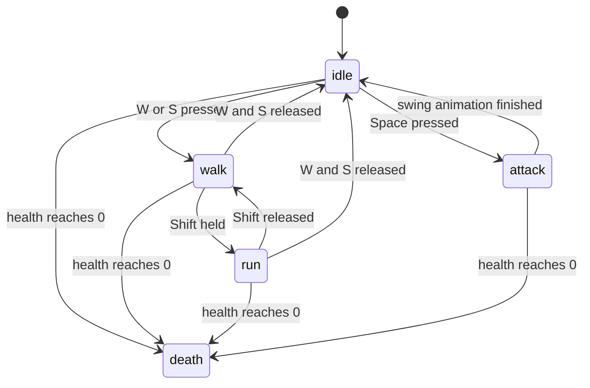

# 1. Game development basics

Before looking at this game's code, here are the handful of ideas that almost every 3D game is built on.
Each section ends with **"In this game"**, pointing at where the idea shows up in the code.

---

## 1.1 A game is a flip-book: the game loop

A film is just still pictures shown very fast. A game is the same, except that every picture
(a **frame**) is *calculated* right before it is shown, based on what the player is doing.

The code that does this is the **game loop**. It runs roughly 60 times per second:

```
forever:
    1. look at the input       (which keys are held down?)
    2. update the world        (move the player, move monsters, apply damage, ...)
    3. draw the world          (turn the 3D world into a 2D picture on the screen)
```

The browser gives us a function, `requestAnimationFrame(callback)`, that says
"call `callback` right before you next repaint the screen". Calling it again from inside the callback
makes a loop that is perfectly in step with the monitor.

**In this game:** `onAnimationFrame` at the bottom of `src/main.js`.

## 1.2 Time between frames ("seconds elapsed")

A fast computer might draw 144 frames per second, a slow one 30. If we moved the player
"1 unit per frame", they would run 5 times faster on the fast computer!

So every update gets the **time since the previous frame**, in seconds — usually about `0.016`
(that is 1/60 of a second). Movement is always written as *speed × time*:

```js
position += speed * secondsElapsed;   // same speed on every computer
```

This game also caps the time at 1/30 of a second, so that if the browser tab was in the background
for a while, nobody teleports across the map when you come back.

**In this game:** every `update(secondsElapsed)` function.

## 1.3 The 3D world: scene, mesh, camera, light, renderer

We use a library called **three.js** to do the hard 3D maths. It has five main ideas:

| three.js idea | Real-world comparison |
|---------------|----------------------|
| **Scene** | A film set. Everything that should be visible is added to it. |
| **Mesh** (or *model*) | A prop on the set: a shape (geometry, made of triangles) plus a material (colour, texture, shininess). |
| **Camera** | The film camera. Only what it sees ends up on screen. |
| **Light** | Lamps on the set. Without them, everything is black. |
| **Renderer** | The camera operator who takes the picture and puts it into the web page's `<canvas>`. |

Every frame: `renderer.render(scene, camera)` — "take a picture of this set with this camera".

The artists' 3D models are stored in files (`.fbx`, `.glb`). A **loader** reads such a file and
gives back a ready-to-use mesh, possibly with a skeleton and animations.

How these pieces nest inside each other is explained in detail in [three.js concepts](02-threejs-concepts.md).

**In this game:** `src/main.js` creates the renderer, camera, sun, ground and sky. `src/model-component.js`,
`src/player-entity.js` and `src/monster-controller.js` load model files.

## 1.4 Coordinates: x, y, z

Every point in the world is three numbers:

```
        y (up)
        |
        |
        +------ x (right)
       /
      /
     z (towards you / "forward" for the characters here)
```

The ground is the flat x–z plane at `y = 0`. The world in this game is about 1000 × 1000 units.
A **unit** has no fixed size; here one unit is very roughly 30 cm (the knight is about 6 units tall).

## 1.5 Vectors

A **vector** is just those three numbers bundled together: `new THREE.Vector3(x, y, z)`.
It can mean a **position** ("where") or a **direction / velocity** ("which way, and how fast").

Things you will see done with vectors:

| Operation | Meaning |
|-----------|---------|
| `a.add(b)` | Move point `a` by `b` |
| `a.sub(b)` | The arrow from `b` to `a` |
| `v.normalize()` | Keep the direction but make the length exactly 1 |
| `v.multiplyScalar(5)` | Make it 5 times as long |
| `a.dot(b)` | For two length-1 vectors: 1 if they point the same way, 0 if at right angles, −1 if opposite. Used to check "is the monster in front of me?" |
| `a.lerp(b, 0.1)` | Move `a` 10% of the way towards `b` (see *linear interpolation* below) |

## 1.6 Rotations: quaternions

A rotation could be stored as three angles, but that has nasty problems (look up "gimbal lock" if curious).
3D engines use a **quaternion** instead: four numbers that describe "rotate by this much around this axis".
You never need to read the four numbers yourself. You only use it like this:

```js
const forward = new THREE.Vector3(0, 0, 1).applyQuaternion(rotation); // which way am I facing?
rotation.multiply(turnALittle);                                       // turn a bit more
```

## 1.7 Linear interpolation ("lerp") — smooth movement

To *interpolate* is to find a value in between two others. **Linear interpolation** with an amount
from 0 to 1:

```
linearInterpolate(0.0, 10, 20) = 10
linearInterpolate(0.5, 10, 20) = 15
linearInterpolate(1.0, 10, 20) = 20
```

Doing "move 10% closer to the target" every frame gives a smooth, slightly springy motion.
The camera and the floating health bars use this trick, so they glide instead of jumping.

**In this game:** `linearInterpolate` in `src/math.js`; `.lerp(...)` in `src/third-person-camera.js`.

## 1.8 Skeletons and animation

Characters are not a solid statue. Inside the mesh is a **skeleton** of **bones** (joints: hips, knees,
right hand, …). The skin follows the bones. An **animation clip** (e.g. "walk") is a recording of how
every bone moves over a second or two.

three.js plays clips with:

- **AnimationMixer** — one per character, it actually moves the bones every frame (`mixer.update(seconds)`).
- **AnimationAction** — one per clip; you `play()` it, set it to loop or play once, and
  **cross-fade** from one clip to another so the change from "walk" to "run" is smooth instead of snapping.

Because the weapon is attached to the "RightHandIndex1" bone, it automatically follows the hand.

**In this game:** `src/player-state.js` (which clip plays when), `src/equip-weapon-component.js` (sword on the hand bone).

## 1.9 A finite state machine — "what am I doing right now?"

The knight is always doing **exactly one** of: *idle*, *walk*, *run*, *attack*, *death*.
Each of these is a **state**. Rules say when to move to another state:



"Finite" just means there is a fixed list of states. This pattern keeps character logic tidy:
each state only has to think about its own situation.

**In this game:** `src/finite-state-machine.js` (the machine), `src/player-state.js` (the states).

## 1.10 Collision and "who is near me?"

To stop the knight walking through a tree, or to find what the sword hits, the game must ask
"which things are near this point?". Checking all ~170 objects every frame for every character would
be slow. So the map is cut into a grid of 100 × 100 squares (**cells**), and every object is listed in the
cell it stands in. To find neighbours you only look in the few cells around you.
This is called a **spatial hash grid** ("spatial" = about space/position).

**In this game:** `src/spatial-hash-grid.js` and `src/spatial-grid-controller.js`.

## 1.11 Shaders — tiny programs on the graphics card

The graphics card (GPU, graphics processing unit) draws millions of pixels per frame. You can give it
small programs, written in a language called GLSL (OpenGL Shading Language), to control how
something is drawn. There are always two:

| Shader | Runs once per … | Its job |
|--------|-----------------|---------|
| **Vertex shader** | corner (vertex) of every triangle | Decide *where* on screen that corner goes. |
| **Fragment shader** | pixel the triangle covers | Decide *what colour* that pixel is. ("Fragment" is the graphics word for "a pixel being drawn".) |

Values passed from JavaScript to a shader are called **uniforms** (same for every pixel), values passed
from the vertex shader to the fragment shader are called **varyings** (they vary smoothly across the triangle).

Most objects use three.js's built-in shaders. This game writes three of its own:
the gradient sky (`src/main.js`), the floating health bars (`src/health-bar.js`), and the level-up
sparkles (`src/particle-system.js`).

## 1.12 Particles

Fire, smoke, sparkles and magic are usually **particles**: hundreds of tiny flat images, each with its
own position, speed, colour, size and remaining life. Every frame they move, fade, and are deleted when
their life runs out.

**In this game:** `src/particle-system.js`, used by `src/level-up-component.js`.
