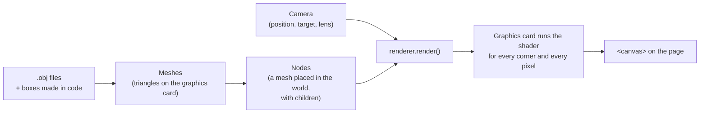
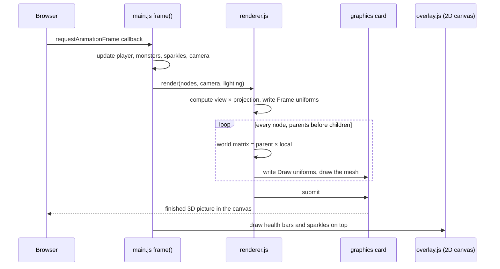

# 2. How 3D drawing works

The game draws its 3D world itself, with about 250 lines in `src/renderer.js` and `src/matrix.js`.
This chapter explains every idea those files use, from the top down.

---

## 2.1 The big picture



Every frame, `main.js` calls `renderer.render(nodes, camera, lighting)`, and a new picture appears.

## 2.2 The graphics card and WebGPU

A screen has about two million pixels and we redraw them 60 times a second. The ordinary processor (CPU)
is too slow for that, so the work goes to the **graphics card** (GPU, graphics processing unit), which has
thousands of small cores that each colour a few pixels at the same time.

**WebGPU** is the browser's way to use the graphics card from JavaScript. The steps, all in `createRenderer`:

| WebGPU object | What it is |
|---------------|------------|
| `navigator.gpu.requestAdapter()` | "Find me a graphics card." |
| `adapter.requestDevice()` | "Let me use it." The **device** creates everything else. |
| `canvas.getContext('webgpu')` + `configure` | Connect the device to the `<canvas>` on the page. |
| **Buffer** | A block of memory on the graphics card: corner data of a model, or a few numbers like a matrix. |
| **Texture** | A picture on the graphics card. The canvas itself is also a texture we draw into. |
| **Shader module** | Our shader program (see 2.8). |
| **Pipeline** | The full recipe for drawing: which shader, how the corner data is laid out, whether to use depth. |
| **Bind group** | A bundle of "inputs" handed to the shader: buffers, textures. |
| **Command encoder / render pass** | A list of drawing commands, recorded and then sent (`submit`) in one go. |

All of these are created once at start-up, except the render pass, which is recorded every frame.

## 2.3 Meshes: everything is triangles

The graphics card can only draw **triangles**. A box is 12 triangles (2 per side); a tree is about 3000.
A **mesh** is a list of triangles, where each corner (**vertex**) has:

| Value | Meaning |
|-------|---------|
| position | x, y, z of the corner |
| normal | the direction the surface faces there; used to light it (surfaces facing the sun are brighter) |
| texture coordinate | which point of a picture to show there (see 2.4) |
| colour | the colour to use when there is no picture |

That is 11 numbers per corner, packed one after the other into one buffer (`createMesh` in `renderer.js`).

Where meshes come from:

- **Boxes made in code** (`src/shapes.js`): the knight, the girl, the ground, the round shadows.
- **OBJ files** (`src/obj-loader.js`): trees, clouds, monsters, weapons. See 2.10.

## 2.4 Material and texture — what is the difference?

They are two layers, one inside the other:

- A **material** is the *recipe* for how a surface looks: its colour, how shiny it is, whether it reacts to
  light, whether it is see-through.
- A **texture** is a *picture*. It is one optional *ingredient* of a material: "take the colour from this
  picture instead of one plain colour".

```
material  ──  colour:   plain colour  OR  texture (picture)
          ──  lighting: on / off
          ──  (shininess, transparency, ... — not used here)
```

To know which point of the picture belongs to which corner, every corner has a **texture coordinate**
(also called **UV**): two numbers from 0 to 1 — how far across (u) and how far down (v) the picture.

This game keeps materials minimal. Each node can have:

- a **texture** (monsters: their `_Texture.png`), otherwise the corner colours are used;
- a **tint**: a colour the result is multiplied by (clouds use `[1.2, 1.2, 1.2]` to look brighter);
- **unlit**: ignore the sunlight (clouds).

## 2.5 Nodes: placing meshes in the world, and the hierarchy

A mesh describes a shape around its own centre. To place it in the world we wrap it in a **node**
(`createNode` in `renderer.js`):

| Field | Meaning |
|-------|---------|
| `mesh` | what to draw (or `null` for an invisible joint) |
| `position` | `{ x, y, z }` — where, **relative to the parent node** |
| `rotation` | `{ x, y, z }` angles in radians — turned around each axis |
| `scale` | one number — 2 means twice as big |
| `children` | other nodes attached to this one |
| `texture`, `tint`, `unlit` | the material settings from 2.4 |

Because nodes have children, they form a **tree** (often called the **scene graph**).
A child moves, turns and resizes together with its parent. The knight is such a tree:

```
knight root            ← position = where the knight stands, rotation.y = facing
├── body               ← bobs up and down
│   ├── torso box
│   ├── chest armour box
│   ├── head
│   │   └── visor box
│   ├── left arm pivot (shoulder)     ← rotation.x swings the arm
│   │   ├── arm box (hangs below the shoulder)
│   │   └── shield box
│   └── right arm pivot (shoulder)
│       ├── arm box
│       └── right hand (empty node at the end of the arm)
│           └── sword                 ← loaded from Sword.obj
├── left leg pivot (hip)
│   └── leg box
├── right leg pivot (hip)
│   └── leg box
└── round shadow
```

So to swing the sword we only turn the **right arm pivot**. The hand, and the sword in it, follow
automatically. To move the whole knight we only change the root.

## 2.6 Matrices: move, turn, resize in one package

How does the renderer apply "position, then rotation, then scale, then the parent's, then the
grandparent's…" to thousands of corners quickly? With **matrices**.

A **4 × 4 matrix** is a grid of 16 numbers that describes a *transformation*: a combination of moving,
turning and resizing. Two key facts are all you need:

1. Applying a matrix to a point moves/turns/resizes that point.
2. **Multiplying** two matrices gives one matrix that does both, one after the other.

`src/matrix.js` has a function for each basic transformation — `translation` (move), `rotationX/Y/Z`
(turn), `scaling` (resize) — and `multiply`. In `renderer.js`:

```js
// a node's own transformation: move × turn × resize
local = translation(position) × rotationY × rotationX × rotationZ × scaling(scale)

// its place in the world: the parent's world matrix × its own
world = parentWorld × local
```

`drawNode` walks down the tree doing exactly this, so every mesh gets one final **world matrix**.
The graphics card then applies it to every corner of that mesh.

> **Rotation, position and scale are three separate things.** Some engines store rotation as a
> *quaternion* (four numbers); it still holds *only* the rotation, never position or scale.
> This game uses three plain angles instead, which is enough because nothing spins in complicated ways.
> The matrix is what combines all three.

## 2.7 The camera: view and projection

The camera is two more matrices (`render` in `renderer.js`):

- **View matrix** (`lookAt(position, target)`): moves and turns the *whole world* so the camera ends up
  at the centre looking straight ahead. (It's easier to move the world than the camera!)
- **Projection matrix** (`perspective(fieldOfView, aspectRatio, near, far)`): the lens. It makes far things
  smaller and squeezes everything the camera can see into a box the graphics card understands.
  `fieldOfView` is how wide the lens sees (60°); `near` (1) and `far` (10000) are the closest and furthest
  distances that are drawn.

They are multiplied into one `viewProjection` matrix. For every corner the graphics card computes
`viewProjection × worldMatrix × cornerPosition`, which gives the corner's spot on screen.

`renderer.project(point)` does the same maths in JavaScript for one point. The 2D overlay uses it to find
where to draw a health bar, and the mouse code uses it to check if you clicked the girl.

## 2.8 Shaders: programs on the graphics card

The program the graphics card runs is the **shader**, written in **WGSL** (WebGPU Shading Language), a
small language that looks a bit like Rust/TypeScript. It is the `SHADER` text at the top of `renderer.js`
and has two functions:

| Function | Runs once per … | Job |
|----------|-----------------|-----|
| `vertexMain` (**vertex shader**) | corner | Multiply the corner by the matrices → its place on screen. Pass the normal, colour and texture coordinate on. |
| `fragmentMain` (**fragment shader**) | pixel covered by a triangle ("fragment" = a pixel being drawn) | Choose the colour: texture or corner colour, × tint, × sunlight, then blend into fog with distance. |

Values between the corners of a triangle are blended smoothly for each pixel automatically.

Inputs that are the same for many corners are called **uniforms**: the `Frame` values (camera, sun, fog)
are the same for the whole picture; the `Draw` values (world matrix, tint, settings) are the same for one node.

**Lighting** in one line: `brightness = 0.55 + 0.6 × max(0, normal · sunDirection)`. The 0.55 is light that
reaches everywhere (so shadows are not black); the rest depends on how directly the surface faces the sun.

**Fog**: `fogAmount = 1 − e^−(density × distance)²` — 0 nearby, approaching 1 far away. The pixel colour is
blended towards the fog colour by that amount, so distant trees fade into the horizon.

## 2.9 Depth: what is in front?

When a tree is behind the knight, the knight's pixels must win. The **depth buffer** is a hidden picture,
the same size as the screen, that stores *how far away* the thing drawn at each pixel is. Before a pixel
is coloured, its distance is compared with the stored one; if something nearer is already there, the new
pixel is thrown away. So models can be drawn in any order. (`depthStencil` in the pipeline.)

## 2.10 Model file formats: OBJ, FBX, GLTF

Artists make models in tools like Blender and save them in a **file format**. A format is just an agreed
way of writing triangles (and maybe more) into a file. Every format needs its own **loader** — code that
reads that format. The common ones:

| Format | Made by | Can hold | Notes |
|--------|---------|----------|-------|
| **OBJ** (`.obj` + `.mtl`) | Wavefront, 1990s | triangles, texture coordinates, normals, material colours | Plain text, very simple. No skeletons, no animations. |
| **FBX** (`.fbx`) | Autodesk | everything: skeletons, animations, cameras… | Binary and complicated; the format is not fully public. |
| **GLTF / GLB** (`.gltf`, `.glb`) | Khronos (the group behind WebGL/Vulkan) | everything, designed for real-time 3D | The modern open standard; ".glb" is the one-file binary version. |

So "FBXLoader vs GLTFLoader" is not a choice of style: the art came in those formats, and each format
needs a different reader. This project's art folders also include **OBJ** copies, and since we animate
in code (1.7) we don't need skeletons — so OBJ, the simplest format, is enough. Its loader is about
100 lines: `src/obj-loader.js`. The format itself is described at the top of that file.

## 2.11 One frame, from start to finish



Why **update first, then draw**? So the picture shows the world as it is *now*, including this frame's
key presses. (Drawing first would show last frame's world; with 60 frames a second nobody would notice,
but update-then-draw is the natural order.)

The sky is not drawn by the renderer at all: the canvas is cleared to *transparent*, and the blue
gradient is the page's background behind it (`.container` in `base.css`).
