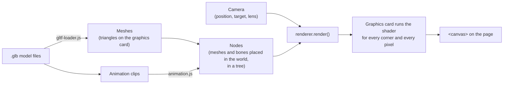
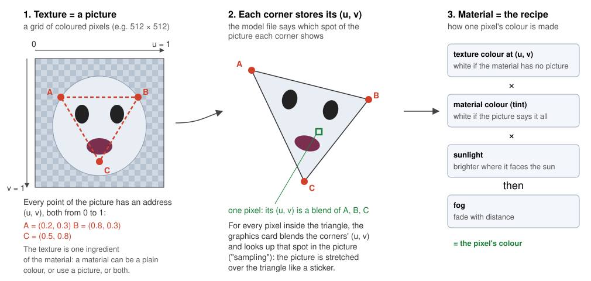
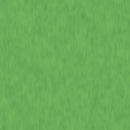
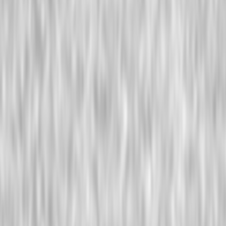
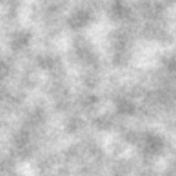

# 2. How 3D drawing works

The game draws its 3D world itself, without any library: `src/renderer.js` (WebGPU drawing),
`src/matrix.js` (the maths), `src/gltf-loader.js` (reading model files) and `src/animation.js`
(moving the skeletons). This chapter explains every idea those files use, from the top down.

---

## 2.1 The big picture



Every frame, `main.js` moves the characters, `animation.js` poses their skeletons, and
`renderer.render(nodes, camera, lighting)` turns it all into a picture.

## 2.2 The graphics card and WebGPU

A screen has about two million pixels and we redraw them 60 times a second. The ordinary processor (CPU)
is too slow for that, so the work goes to the **graphics card** (GPU, graphics processing unit), which has
thousands of small cores that each colour a few pixels at the same time.

**WebGPU** is the browser's way to use the graphics card from JavaScript. The pieces, all set up in `createRenderer`:

| WebGPU object | What it is |
|---------------|------------|
| `navigator.gpu.requestAdapter()` | "Find me a graphics card." |
| `adapter.requestDevice()` | "Let me use it." The **device** creates everything else. |
| `canvas.getContext('webgpu')` + `configure` | Connect the device to the `<canvas>` on the page. |
| **Buffer** | A block of memory on the graphics card: corner data of a model, or a few numbers like a matrix. |
| **Texture** | A picture on the graphics card. The canvas itself is also a texture we draw into. |
| **Shader module** | Our shader program (see 2.9). |
| **Pipeline** | The full recipe for drawing: which shader, how the corner data is laid out, whether to use depth. |
| **Bind group** | A bundle of inputs handed to the shader for one model: its matrix, colour, picture, bones. |
| **Command encoder / render pass** | A list of drawing commands, recorded and then sent (`submit`) in one go. |

All of these are created once at start-up, except the render pass, which is recorded every frame.

## 2.3 Meshes: everything is triangles

The graphics card can only draw **triangles**. A tree is about 3 000 of them, the knight about 4 500.
A **mesh** is a list of triangles, where each corner (**vertex**) has:

| Value | Meaning |
|-------|---------|
| position | x, y, z of the corner |
| normal | the direction the surface faces there; used for lighting (surfaces facing the sun are brighter) |
| texture coordinate (u, v) | which point of the texture picture to show there (see 2.4) |
| bones and weights | for characters: which bones pull this corner, and how strongly (see 2.6) |

That is 16 numbers per corner, packed one after the other into one buffer (`createMesh` in `renderer.js`).

## 2.4 Material and texture

These two words are easy to mix up. In one sentence: **the material is the recipe for how a surface looks;
the texture is a picture that the recipe can use as an ingredient.**



### The texture: a picture

A **texture** is an ordinary picture: a grid of coloured pixels. This is the whole texture of the ghost
monster, `resources/monsters/Textures/Ghost_Texture.png` (512 × 512 pixels):


It doesn't look like a ghost, because it was made to be *wrapped around* the ghost: the artist painted
each region of the picture for one part of the model — a patch for the body, a patch for the eyes, and so on.

### Wrapping the picture around the model: texture coordinates

Every point of a picture has an address **(u, v)**: how far across (u) and how far down (v), each from
0 to 1. The top-left corner is (0, 0), the bottom-right corner (1, 1).

When the artist builds the model, they decide for every corner of every triangle which spot of the
picture it shows, and store that spot's (u, v) in the model file next to the corner's position.
So a triangle on the ghost's face has corners A, B and C, and the file says: A shows (0.2, 0.3) of the
picture, B shows (0.8, 0.3), C shows (0.5, 0.8) — as in the diagram above.

Then, when drawing, for **every pixel** inside that triangle:

1. The graphics card works out how close the pixel is to each of the three corners, and blends their
   (u, v) accordingly. A pixel right next to A gets about (0.2, 0.3); one in the middle gets an average.
2. The shader reads the picture at that (u, v) — this is called **sampling**. Our **sampler** is set to
   `linear`, which blends the four nearest pixels of the picture, so close-ups look smooth, not blocky.

The effect is that the picture is stretched over the triangle like a sticker.

### The material: the recipe

A **material** describes everything about how a surface looks. Model files (glTF) can describe a lot:
a base colour, a base colour picture, how metallic and rough it is, a "normal map" picture for fine
bumps, a glow colour, transparency… This game uses only the essentials. For each piece of a model it keeps:

| Material setting | Where it comes from | Used as |
|------------------|---------------------|---------|
| **base colour** | `baseColorFactor` in the .glb file | `node.tint` |
| **base colour texture** (optional) | `baseColorTexture` in the .glb file, or a separate .png | `node.texture` |
| **texture scale** (optional) | set by the game for models without texture coordinates | `node.textureScale` (see "Triplanar mapping" below) |

And the recipe, in the fragment shader (`renderer.js`), for one pixel:

```wgsl
// 1. the picture's colour at this pixel — at the model's (u, v), or by triplanar mapping;
//    models without a picture use a plain white one
let fromModel = textureSample(colourTexture, colourSampler, input.textureCoordinate).rgb;
let fromWorld = triplanar(input.worldPosition, input.normal, draw.settings.x);
// 2. times the material's base colour
var colour = select(fromModel, fromWorld, draw.settings.x > 0.0) * draw.tint.rgb;
// 3. times the sunlight
colour = colour * (0.55 + 0.6 * sunLight);
// 4. faded into the fog with distance
return vec4f(mix(colour, frame.fog.rgb, fogAmount), 1.0);
```

Multiplying by white (1, 1, 1) changes nothing, which is why "no picture" uses a white picture and
"no colour" uses a white colour: then the same recipe works for every model.

### The kinds of models in this game

| Model | Texture | Material colour | Result |
|-------|---------|-----------------|--------|
| Knight, girl | a picture stored **inside** the .glb file | white | the picture |
| Monsters | a picture in a **separate** .png (`resources/monsters/Textures/`), given to the model by `monster.js` | white | the picture |
| Ground | `grass.png`, a small **coloured** picture repeated every 12 units | white | the grass picture |
| Trees | `bark.png` or `leaves.png`, small **grey** pictures, by triplanar mapping | one colour **per piece**: "Wood", "Green", … | the piece's colour with streaks or clumps |
| Weapons | none | one colour per piece ("LightSteel", "DarkWood", …) | plain colours |

Everything is lit by the sun. A model with several materials is split into several meshes, one per
material (glTF calls them **primitives**). A tree is two meshes: the trunk and the leaves.

A **grey** texture multiplied with a colour keeps the colour but adds a pattern: white parts leave the
colour as it is, darker parts darken it. That is how one `leaves.png` serves every tree: green leaves
stay green, dark green leaves stay dark green, all with the same clumpy pattern.

The three small pictures (256 × 256 pixels each) are made by `tools/make-textures.py`:

| grass.png | bark.png | leaves.png |
|-----------|----------|------------|
|  |  |  |

They are **seamless**: the right edge continues the left edge and the bottom continues the top, so
they can be repeated without visible lines. The grass picture has only small details on purpose: a big
light patch in it would appear again every 12 units, in a grid across the whole ground.

### Repeating a picture

The ground is 5 000 units wide; one picture stretched over all of it would be a blur. Instead its
texture coordinates go from 0 to about 400 (`groundGeometry(5000, 12)`: one picture every 12 units), and
the sampler is set to `repeat`: u = 3.25 shows the same spot as u = 0.25. The picture is tiled like floor tiles.

### Triplanar mapping: a picture on a model without texture coordinates

The tree models were made as plain coloured shapes, so their corners have no (u, v).
**Triplanar mapping** invents them from the position in the world. Imagine three slide projectors shining the
same picture onto the model: one from above (using x and z as u and v), one from the front (x and y), one
from the side (z and y). Each surface takes mostly the picture of the projector it faces — the top of a
leaf clump from the one above, a trunk from the side ones — blended by its normal, so the picture never
looks smeared. `node.textureScale` sets how big the picture is: 0.3 means it repeats every 1 / 0.3 ≈ 3 units.
(`triplanar` in the shader in `renderer.js`.)

It costs three picture reads per pixel instead of one, which is little for a graphics card.

### Mipmaps: calm pictures in the distance

Far away, a whole 256-pixel picture may shrink to a few pixels on screen. Reading single pixels of the full
picture there gives a random, flickering result. So with each picture we store **mipmaps**: copies at half
the size, a quarter, an eighth… down to 1 × 1, each one smoothly shrunk. The graphics card reads the copy
that fits the size on screen (`createTextureFromImage` in `renderer.js`; sampler setting `mipmapFilter`).
The sampler's `maxAnisotropy` additionally keeps surfaces seen at a slant, like the ground, sharp.

### Smooth normals: round instead of faceted

The models are "low poly": few, large triangles. If every triangle has its own normal, each is lit evenly
and the edges show sharply. For trees the loader instead gives corners that share a spot the
**average** normal of all their triangles (`smoothNormals` in `gltf-loader.js`). The light then changes
gradually across the surface, and the leaves look round and soft.

### Sprites: the clouds

Clouds have no hard surface, so a solid 3D model of a cloud — even a smoothed and textured one — still
looks like a lump. Instead each cloud is a **sprite** (also called a *billboard*): a flat, soft,
see-through picture placed at a spot high in the world and always facing the camera.


`cloud.png` has a fourth number per pixel besides red, green and blue: **alpha**, how solid the pixel is.
The edges fade from solid to fully see-through, so the cloud blends softly into the sky.

`src/sky.js` draws the clouds on a separate 2D canvas *behind* the 3D picture. Each frame it asks
`renderer.project` where a cloud's centre, top and bottom are on screen, which gives its position and
how big it looks from this distance, and draws the picture there. Far clouds fade out the same way
fog works. Because the sky canvas is behind the 3D canvas, trees and characters always cover the clouds.

### How it reaches the graphics card

1. `gltf-loader.js` reads the material from the file. If it has a picture, the picture's bytes are
   turned into a **texture** on the graphics card (`createTextureFromImage`).
2. Each piece of the model becomes a node with `texture` and `tint` set.
3. `renderer.js` creates a **bind group** for the node: its matrix and tint (binding 0), its texture
   (binding 1), the sampler (binding 2) and its bones (binding 3).
4. Before drawing the node, `pass.setBindGroup(1, ...)` hands exactly those to the shader.

## 2.5 Nodes: placing things in the world, and the hierarchy

A mesh describes a shape around its own centre. To place it in the world we put it in a **node**
(`createNode` in `renderer.js`):

| Field | Meaning |
|-------|---------|
| `mesh` | what to draw (or `null` for a node that only holds other nodes, or a bone) |
| `position` | `{ x, y, z }` — where, **relative to the parent node** |
| `rotation` or `quaternion` | which way it is turned (see 2.7) |
| `scale` | how big: 3 means three times as big |
| `children` | nodes attached to this one |
| `texture`, `tint`, `textureScale` | the material (2.4) |
| `skin` | for characters: the bones that move this mesh (2.6) |

Because nodes have children, they form a **tree** (often called the **scene graph**). A child moves,
turns and resizes together with its parent. The knight, simplified (the real skeleton has 41 bones):

```
knight's own node (character.js)   ← position = where he stands, rotation = facing; the game moves this
├── size node (scale 3)            ← the file is in metres; the game world is 3 times bigger
│   └── model root (from knight.glb)
│       ├── Hips                   ← bones: nodes without meshes, moved by the animation
│       │   ├── Spine → Spine1 → Spine2
│       │   │   ├── Neck → Head
│       │   │   ├── RightShoulder → RightArm → RightForeArm → RightHand → RightHandIndex1
│       │   │   │                                                         └── the sword (main.js)
│       │   │   └── LeftShoulder → LeftArm → ...
│       │   ├── RightUpLeg → RightLeg → RightFoot → ...
│       │   └── LeftUpLeg → ...
│       └── Guard02                ← the skin: one mesh, tied to all the bones above
└── round shadow (shapes.js)
```

To move the knight, the game changes only his own node. To swing the sword, the animation turns the
arm bones; the hand, and the sword attached to it, follow.

## 2.6 Skinning: how the skin follows the bones

The knight's skin is one mesh — a single continuous surface, so the elbow bends smoothly instead of
being two separate tubes. Each corner of the skin stores up to four **bones** and four **weights**
(adding up to 1): a corner on the forearm might be 100 % `RightForeArm`; a corner on the elbow
50 % `RightArm` and 50 % `RightForeArm`.

The skin was modelled in a resting pose (arms out, the "T-pose"). For each bone, the file also stores its
**inverse bind matrix**: the opposite of where the bone was in that resting pose. Then, every frame:

1. `animation.js` sets each bone's position and rotation from the animation clip.
2. `renderer.js` works out every node's place in the world (2.7).
3. For each bone: `bone's world matrix × inverse bind matrix` = "how far this bone has moved from the
   resting pose" (`skinMatrices`). These matrices go to the graphics card.
4. In the vertex shader, each corner is moved by its bones' matrices, blended by its weights:

```wgsl
let skin = boneMatrices[bones.x] * weights.x + boneMatrices[bones.y] * weights.y + ...;
let worldPosition = draw.model * skin * vec4f(position, 1.0);
```

Models without a skeleton (trees, weapons, the ground) get a single "do nothing" bone, so the same shader works for everything.

## 2.7 Matrices: move, turn, resize in one package

How does the renderer apply "position, then rotation, then scale, then the parent's, then the
grandparent's…" to thousands of corners quickly? With **matrices**.

A **4 × 4 matrix** is a grid of 16 numbers that describes a combination of moving, turning and resizing.
Two facts are all you need:

1. Applying a matrix to a point moves/turns/resizes that point.
2. **Multiplying** two matrices gives one matrix that does both, one after the other.

`src/matrix.js` has a function for each basic step — `translation` (move), `rotationX/Y/Z` or
`rotationFromQuaternion` (turn), `scaling` (resize) — and `multiply`. In `renderer.js`:

```js
local = translation(position) × rotation × scaling(scale)   // the node's own move, turn, resize
world = parent's world × local                               // its place in the world
```

`updateWorldMatrices` walks down the tree doing exactly this, so every node gets one **world matrix**.

**Two ways to store a rotation:**

- **Three angles** `{ x, y, z }` — easy to read: "turned 90° to the left". The game uses this for its own
  nodes, e.g. a character's facing.
- A **quaternion** `[x, y, z, w]` — four numbers meaning "turned by this much around this axis". Model
  files use these for bones, because two quaternions can be blended smoothly (needed for animation and
  cross-fading), while blending angles can make limbs flip the wrong way round.

Either way it is **only the rotation**. Position and scale are always separate; the matrix is what combines all three.

## 2.8 The camera: view and projection

The camera is two more matrices (`render` in `renderer.js`):

- **View matrix** (`lookAt(position, target)`): moves and turns the *whole world* so the camera ends up
  at the centre looking straight ahead. (Moving the world is easier than moving the camera!)
- **Projection matrix** (`perspective(fieldOfView, aspectRatio, near, far)`): the lens. It makes far things
  smaller. `fieldOfView` is how wide the lens sees (60°); `near` (1) and `far` (10 000) are the closest and
  furthest distances that are drawn.

They are multiplied into one `viewProjection` matrix. For every corner the graphics card computes
`viewProjection × world × skin × corner`, which gives the corner's spot on screen.

`renderer.project(point)` does the same maths in JavaScript for one point. The 2D overlay uses it to find
where to draw a health bar, and the mouse code uses it to check if you clicked the girl.

## 2.9 Shaders: programs on the graphics card

The program the graphics card runs is the **shader**, written in **WGSL** (WebGPU Shading Language).
It is the `SHADER` text at the top of `renderer.js` and has two functions:

| Function | Runs once per … | Job |
|----------|-----------------|-----|
| `vertexMain` (**vertex shader**) | corner | Skin it (2.6), then multiply by the matrices → its place on screen. |
| `fragmentMain` (**fragment shader**) | pixel covered by a triangle ("fragment" = a pixel being drawn) | Follow the material recipe (2.4): texture × colour × sunlight, then fog. |

Values that stay the same for many corners are **uniforms**: `Frame` (camera, sun, fog) is the same for
the whole picture; `Draw` (matrix, tint, settings) is the same for one node.

**Lighting**: `brightness = 0.55 + 0.6 × max(0, normal · sunDirection)`. The 0.55 is light that reaches
everywhere (so shaded sides are not black); the rest depends on how directly the surface faces the sun.

**Fog**: `fogAmount = 1 − e^−(density × distance)²` — 0 nearby, approaching 1 far away.

## 2.10 Model file formats: FBX, glTF, OBJ

Artists make models in tools like Blender or Maya and save them in a **file format** — an agreed way of
writing triangles, materials, skeletons and animations into a file. Every format needs its own
**loader**: code that reads that format.

| Format | Made by | Can hold | Notes |
|--------|---------|----------|-------|
| **FBX** (`.fbx`) | Autodesk | everything | Binary, complicated, and not fully public. A reader is thousands of lines. |
| **glTF / GLB** (`.gltf`, `.glb`) | Khronos (the group behind WebGL and Vulkan) | everything, designed for real-time 3D | Open standard. The data is laid out the way graphics cards want it, so loading is mostly copying. |
| **OBJ** (`.obj` + `.mtl`) | Wavefront, 1990s | shapes and colours only | Plain text, very simple, but no skeletons or animations. |

So "an FBX loader or a glTF loader" is not a style choice: each reads a different format. The art for
this game came as FBX. We converted it once to **GLB** with `tools/convert-models.sh` (using the
free FBX2glTF tool) and read the GLB files with our own `src/gltf-loader.js`, about 200 lines.

What is inside a `.glb` file:

```
.glb file
├── header: "glTF", version, total length
├── JSON text — the description, everything refers to things by number:
│   ├── nodes:      [{ name: "Hips", translation, rotation, children: [1, 5, 9] }, ...]
│   ├── meshes:     [{ primitives: [{ attributes: { POSITION: 0, NORMAL: 1, ... }, material: 0 }] }]
│   ├── materials:  [{ pbrMetallicRoughness: { baseColorFactor, baseColorTexture } }]
│   ├── skins:      [{ joints: [node numbers], inverseBindMatrices: accessor number }]
│   ├── animations: [{ channels: [{ node, path: "rotation" }], samplers: [{ input: times, output: values }] }]
│   ├── accessors:  "list number 0 is 2 400 groups of 3 decimal numbers, found in bufferView 0"
│   └── bufferViews:"bufferView 0 is bytes 0 to 28 800 of the binary block"
└── binary block — all the numbers, and the pictures as .png bytes
```

## 2.11 Depth: what is in front?

When a tree is behind the knight, the knight's pixels must win. The **depth buffer** is a hidden picture,
the same size as the screen, that stores *how far away* the thing drawn at each pixel is. Before a pixel
is coloured, its distance is compared with the stored one; if something nearer is already there, the new
pixel is thrown away. So models can be drawn in any order. (`depthStencil` in the pipeline.)

## 2.12 One frame, from start to finish

```mermaid
sequenceDiagram
    participant Browser
    participant Game as main.js frame()
    participant Animation as animation.js
    participant Renderer as renderer.js
    participant GPU as graphics card
    participant Overlay as overlay.js (2D canvas)

    Browser->>Game: requestAnimationFrame callback
    Game->>Game: update player, monsters, sparkles, camera
    Game->>Animation: pose every skeleton for this moment
    Game->>Renderer: render(nodes, camera, lighting)
    Renderer->>Renderer: world matrix of every node (parent × local)
    loop every node with a mesh
        Renderer->>GPU: its matrix, colour, picture, bone matrices; draw
    end
    Renderer->>GPU: submit
    GPU-->>Browser: finished 3D picture in the canvas
    Game->>Overlay: draw health bars and sparkles on top
```

The sky is not drawn by the renderer at all: the canvas is cleared to *transparent*, and behind it are
the clouds (`sky.js`, on their own 2D canvas) and the blue gradient of the page's background
(`.container` in `base.css`).
