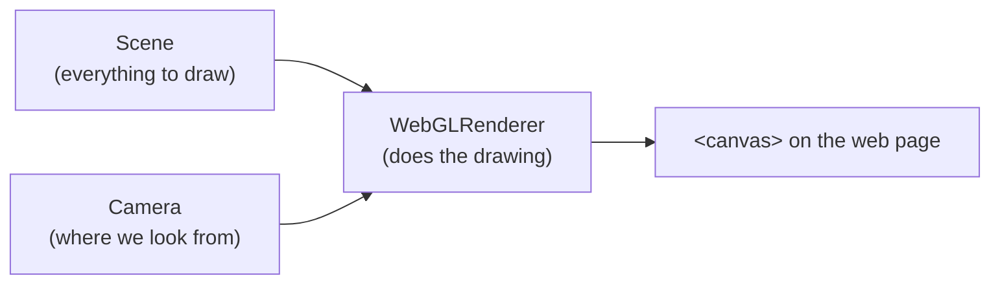
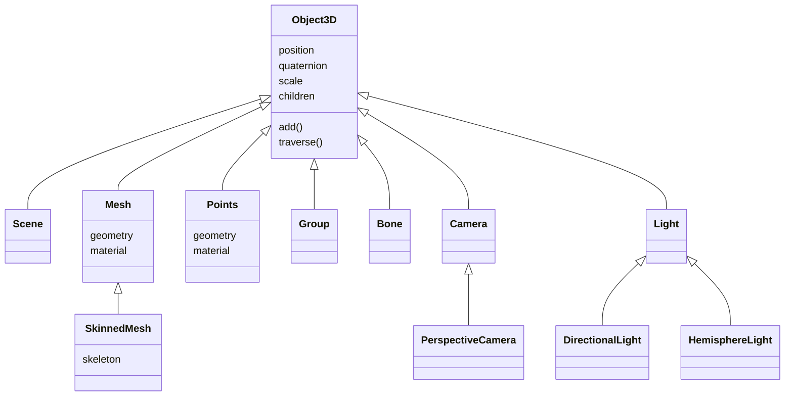
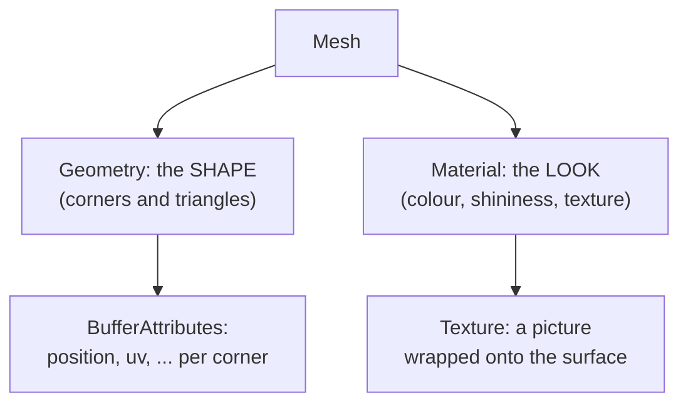
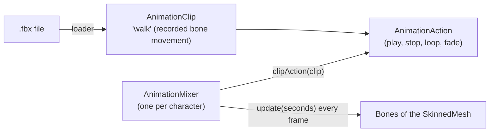
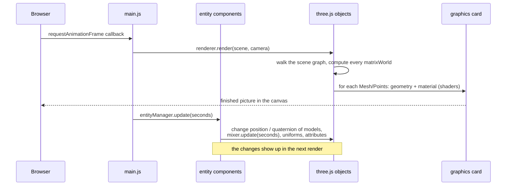

# 2. three.js concepts and how they fit together

The game draws everything with **three.js**, a JavaScript library that hides the difficult graphics-card
code (WebGL) behind friendly objects. This chapter explains those objects, how they are arranged in a
**hierarchy**, and where this game uses each one.

You can always look things up in the official docs: <https://threejs.org/docs/> (this game uses version 0.118).

---

## 2.1 The three top-level pieces

To get one picture on screen you need exactly three things:



```js
renderer.render(scene, camera);   // called once per frame in main.js
```

- **`WebGLRenderer`** — talks to the graphics card. It owns the `<canvas>` element and settings such as
  shadows and colour encoding. There is one in the game (`renderer` in `main.js`).
- **`Scene`** — the root of a tree of objects. Anything not added to the scene (directly or through a parent)
  is not drawn.
- **`Camera`** — a point of view. The game uses one `PerspectiveCamera` (things further away look smaller,
  like a real camera).

## 2.2 Everything in the scene is an `Object3D`

Almost every object in three.js is built on one base type: **`Object3D`**. It is "a thing with a place in
the world". Every `Object3D` has:

| Property / function | Meaning |
|---------------------|---------|
| `position` | A `Vector3`: where it is, **relative to its parent**. |
| `quaternion` (and `rotation`) | Which way it is turned, relative to its parent. |
| `scale` | How big it is (`scale.setScalar(0.035)` shrinks the huge knight file to game size). |
| `children`, `parent` | Its place in the tree. |
| `add(child)` / `remove(child)` | Attach / detach a child. |
| `traverse(callback)` | Call `callback` for itself and every descendant (children, grandchildren, …). |
| `visible`, `castShadow`, `receiveShadow` | Drawing switches. |
| `matrixWorld` | The final, combined position/rotation/scale in the world (calculated by three.js). |

These kinds of objects are all `Object3D`s, so they can all go into the tree:



## 2.3 The scene graph — a family tree of objects

Because objects can contain other objects, the scene is a **tree**, called the **scene graph**.
A child moves, turns and scales together with its parent. This is the tree of this game while it runs (simplified — the real skeleton has dozens of bones):

```
Scene
├── DirectionalLight (the sun)            main.js
├── Mesh (the green ground plane)         main.js
├── HemisphereLight (sky/ground light)    main.js  loadSky
├── Mesh (the sky sphere)                 main.js  loadSky
├── Group (the knight, from castle_guard_01.fbx)          player-entity.js
│   ├── Bone "Hips"
│   │   └── … Bone "Spine" … Bone "RightHand"
│   │                        └── Bone "RightHandIndex1"
│   │                            └── Group (Sword.fbx)    equip-weapon-component.js
│   └── SkinnedMesh (the knight's skin, follows the bones)
├── Group (the girl)                      model-component.js
├── Group × 50 (monsters)                 monster-controller.js
├── Mesh × 50 (health bars)               health-bar.js
├── Group × 100 (trees)                   model-component.js
├── Group × 20 (clouds)                   model-component.js
└── Points (level-up sparkles, when they happen)  particle-system.js
```

**Why the tree matters — the sword example.** The sword is a child of the `RightHandIndex1` bone.
Its `position` is only "a few centimetres from the finger". three.js multiplies the transforms down the
chain — scene → knight → hips → … → hand → sword — to get the sword's real place in the world
(`matrixWorld`). So when the walk animation swings the arm, the sword follows without the game doing anything.

**Local vs. world.** `object.position` is always **local** (relative to the parent). For objects added
directly to the scene, local and world are the same, which is why most of the game can just copy a position.

## 2.4 A `Mesh` = `Geometry` + `Material`

A visible object is a **`Mesh`**, which combines two separate things:



The same geometry can be shared by many meshes with different materials and vice versa.

### Geometry — the shape

- **`BufferGeometry`** — the general shape type. It stores lists of numbers called **attributes**:
  - `position`: x, y, z of every corner (vertex);
  - `uv`: which point of the texture each corner shows;
  - an **index**: which corners form each triangle.
  
  `health-bar.js` builds one by hand: 4 corners, 2 triangles (`[0, 1, 2, 2, 3, 0]`).
  `particle-system.js` rebuilds its attributes every frame (one position, size, colour and angle per particle).
- Ready-made shapes: **`PlaneGeometry`** (the ground) and **`SphereBufferGeometry`** (the sky).
- Model files (`.fbx`, `.glb`) contain their own geometries.

### Material — the look

| Material | Used for | Notes |
|----------|----------|-------|
| `MeshStandardMaterial` | the ground | Realistic lighting ("physically based"). |
| `MeshPhongMaterial` | models from `.fbx` files (knight, monsters, trees, weapons) | Classic shiny-highlight lighting, created by `FBXLoader`. The game sets `specular` (highlight colour) and `emissive` (glow) on trees in `model-component.js`. |
| `MeshStandardMaterial` | models from `.glb` files (clouds) | Created by `GLTFLoader`; the clouds get a grey `emissive` glow so they look bright. |
| `ShaderMaterial` | sky, health bars, particles | You write the shaders yourself (see [Basics 1.11](01-game-development-basics.md#111-shaders--tiny-programs-on-the-graphics-card)). Values are passed in as `uniforms`. |

Useful material settings seen in the code: `map` (the texture), `side` (`DoubleSide` = draw both faces,
`BackSide` = only the inside — used for the sky sphere), `transparent`, `blending`, `depthTest` /
`depthWrite` (whether it hides / is hidden by things in front).

### Texture — a picture on the surface

`new THREE.TextureLoader().load('file.png')` gives a **`Texture`**. Put it in `material.map`.
`texture.encoding = THREE.sRGBEncoding` tells three.js the picture uses normal screen colours.

### `Points` — a cloud of dots

Like a mesh, but every vertex is drawn as a square dot instead of triangles. Perfect for particles.

## 2.5 Cameras

```js
new THREE.PerspectiveCamera(fieldOfViewDegrees, aspectRatio, nearDistance, farDistance)
```

- Only things between `near` (1) and `far` (10000) units away are drawn.
- `camera.lookAt(point)` turns it to face a point (used by the follow camera).
- After the window is resized, `aspect` is updated and `updateProjectionMatrix()` must be called.

## 2.6 Lights and shadows

| Light | Like | In this game |
|-------|------|--------------|
| `DirectionalLight` | The sun: parallel rays from one direction. Has a `target` it points at. | The sun; it casts shadows. |
| `HemisphereLight` | Sky above, ground below: soft light coloured differently from above and below. | Gives the world its blue-ish top / warm bottom fill light. |

**Shadows** need three switches: `renderer.shadowMap.enabled = true`, `light.castShadow = true`, and on each
object `castShadow` / `receiveShadow`. The sun renders the scene from its own point of view into a
**shadow map** (a 4096 × 4096 picture of depths) using `light.shadow.camera`, which only covers 200 × 200
units — that is why `updateSun()` keeps moving the sun with the player.

**Fog** (`scene.fog = new THREE.FogExp2(colour, density)`) is a scene setting, not an object.

## 2.7 Animation objects



- **`AnimationClip`** — the recorded movement, read from a file (`animations[0]`).
- **`AnimationMixer`** — created for one model; `mixer.update(secondsElapsed)` each frame moves the bones.
- **`AnimationAction`** — `mixer.clipAction(clip)` gives you a controller for playing that clip on that model:
  `play()`, `reset()`, `setLoop(THREE.LoopOnce, 1)`, `clampWhenFinished` (freeze on the last frame),
  `crossFadeFrom(otherAction, seconds)`, `time` (how far it has played).
- The mixer fires a `'finished'` event when a play-once action ends (used by `AttackState`).

## 2.8 Loaders

| Loader | Reads | Gives you |
|--------|-------|-----------|
| `FBXLoader` | `.fbx` | A `Group` with meshes, skeleton, and `.animations` |
| `GLTFLoader` | `.glb` / `.gltf` | An object whose `.scene` is a `Group`, plus `.animations` |
| `TextureLoader` | `.png`, `.jpg` | A `Texture` |
| `LoadingManager` | — | Groups several loads; `onLoad` runs when all have finished |

Loading is **asynchronous**: `loader.load(file, callback)` returns immediately and calls `callback` later,
when the file has downloaded. That is why components check "is my model loaded yet?" before using it.

`FBXLoader` and `GLTFLoader` are not part of the core library; they are imported separately from
`examples/jsm/loaders/`.

## 2.9 Maths helpers

| Type | What it is | Used for |
|------|------------|----------|
| `Vector3` | x, y, z | Positions, directions, velocities. See [Basics 1.5](01-game-development-basics.md#15-vectors). |
| `Quaternion` | A rotation | Facing direction of characters. See [Basics 1.6](01-game-development-basics.md#16-rotations-quaternions). |
| `Matrix4` | A 4 × 4 grid of numbers holding position + rotation + scale | `lookAt` to build a "face this way" rotation for monsters. |
| `Color` | r, g, b | Light, fog, health bar colours; `lerpHSL` blends two colours. |
| `Ray` | Start point + direction | Mouse clicking. |
| `Box3` | An axis-aligned box | The click target around a model. |

## 2.10 How it all connects in one frame



The game code never draws anything itself. It only **changes properties of three.js objects**
(positions, rotations, animation times, colours) and three.js draws the result on the next frame.
