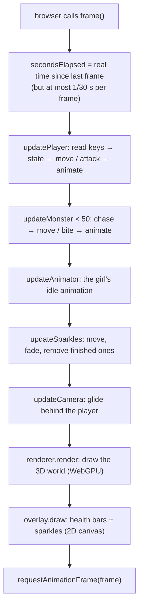
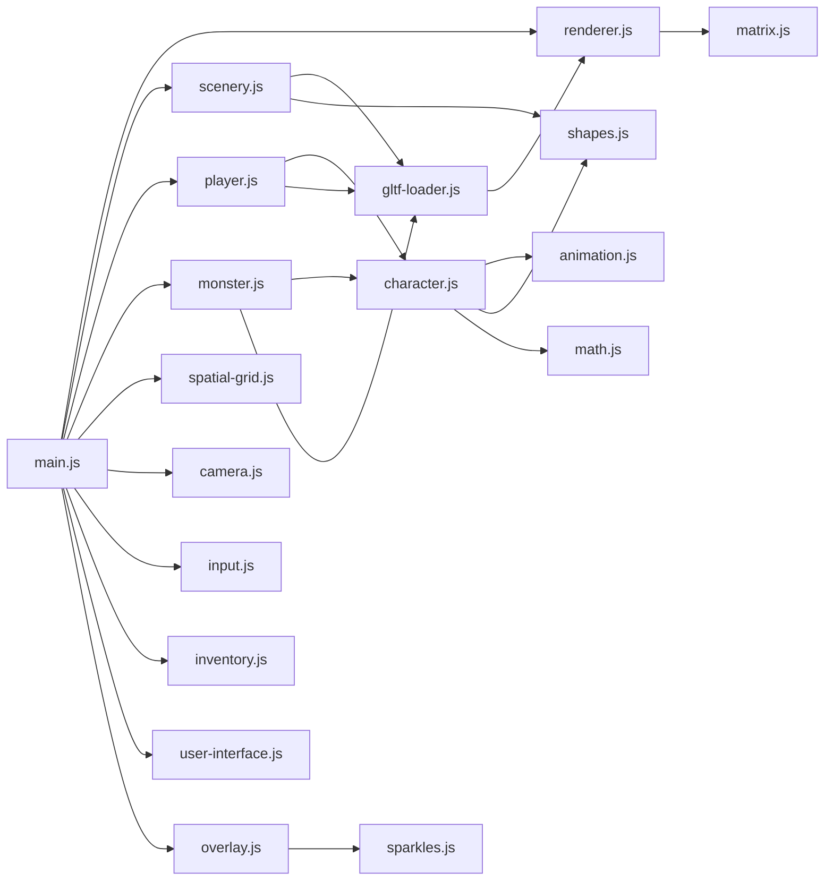

# 3. Architecture

How the code is organised. The guiding rule: **as simple as possible**. No classes, no frameworks,
no libraries — just functions and plain objects.

---

## 3.1 Plain objects with known fields

Every thing in the game is a plain JavaScript object whose fields are listed in one place.
For example, a character (the player or a monster), from `createCharacter` in `src/character.js`:

```js
{
  kind: 'monster',                    // or 'player'
  root,                               // the node that gets drawn (the model is inside it)
  bones,                              // every named part of the model, e.g. bones.RightHandIndex1
  animator,                           // which animation clip is playing (see animation.js)
  clips: { idle, walk, run, attack, death },   // the clip to play in each state
  position: { x, y, z },
  facing: 0,                          // angle around the up axis
  speed: 0,
  state: 'idle',                      // idle / walk / run / attack / death
  hasHit: false,                      // has this swing already done its damage?
  stats: { health, maxHealth, strength, wisdomness, benchpress, curl, experience, level },
  attack: { hitTime, range },        // when in the swing the hit lands, how far it reaches
  weapon: null,                       // the item in hand (player only)
  shownHealth: 1,                     // what the floating health bar currently shows
}
```

Code that needs something just reads the field: `monster.stats.health`, `player.weapon.damage`.

## 3.2 Functions that work on those objects

Each file exports a few functions. "Create" functions build an object; "update" functions change it
once per frame:

| Object | Created by | Updated every frame by |
|--------|-----------|------------------------|
| player | `createPlayer` (player.js) | `updatePlayer(player, keys, world, seconds)` |
| monster | `createMonster` (monster.js) | `updateMonster(monster, world, seconds)` |
| camera | `createCamera` (camera.js) | `updateCamera(camera, player, seconds)` |
| sparkles | `createSparkles` (sparkles.js) | `updateSparkles(sparkles, seconds)` |

Shared behaviour lives in `character.js`, used by both the player and the monsters:
`setState`, `isAlive`, `moveCharacter`, `updateAttack`, `animate`.

There are no classes, components or message systems: the game has a fixed set of kinds of things
(a player, monsters, a girl, trees), so plain objects with known fields are enough.

## 3.3 The `world`: what everyone needs to know

`main.js` makes one `world` object and passes it to the update functions:

```js
const world = {
  player,
  monsters,                     // all 50
  grid,                         // the spatial grid: finds what is near a spot (trees, the girl, characters)
  sparkles,                     // level-up particles currently flying
  onHealthChanged(character),   // called after damage or experience: refreshes the health bar and stats
  onLevelUp(character),         // called on level up: starts the sparkles
};
```

The two `on…` functions let `character.js` say "something happened" without knowing about the
HTML user interface or the sparkles. `main.js` decides what happens.

## 3.4 What happens at start-up

`startGame()` in `src/main.js`:

1. `createRenderer` — connect to the graphics card (WebGPU). If that fails, the reason is shown on the page.
2. Create the user interface, the 2D overlay and the camera.
3. **Load everything at once** and wait for all of it: the knight and his 5 animations, the girl,
   the scenery (ground, 100 trees, 20 clouds) and 50 random monsters. Loading is `async`: each file is
   requested, and `await Promise.all(...)` waits until every one has arrived. Files used many times
   (the same tree, the same monster) are loaded only once; each character gets its own copy of the
   node tree so it can be posed on its own.
4. Make the `world`, put every character and obstacle in the spatial grid, put the axe and sword in the
   inventory, and equip the sword.
5. Listen for keys and clicks.
6. Remove the "Loading…" text and start the game loop.

## 3.5 What happens every frame



## 3.6 Layers of the page

`index.html` stacks, from back to front:

1. The **sky**: just the page background, a blue-to-white gradient (`.container` in `base.css`).
2. `#game-canvas`: the 3D picture (WebGPU). Cleared to transparent, so the sky shows where nothing is drawn.
3. `#overlay-canvas`: a normal 2D canvas for health bars and sparkles. It ignores the mouse (`pointer-events: none`).
4. The HTML user interface: health bar, icons, inventory, statistics, quests.

The page is exactly one screen: `overflow: hidden` on `html` and `body`, so there are no scrollbars.

## 3.7 Which file uses which



Three layers:

- **Drawing** — `renderer.js`, `matrix.js`, `shapes.js`, `gltf-loader.js`, `animation.js`: know nothing about the game.
- **Game rules** — `character.js`, `player.js`, `monster.js`, `spatial-grid.js`, `sparkles.js`, `camera.js`: know nothing about HTML.
- **Page** — `main.js`, `input.js`, `inventory.js`, `user-interface.js`, `overlay.js`: connect the two to the web page.
