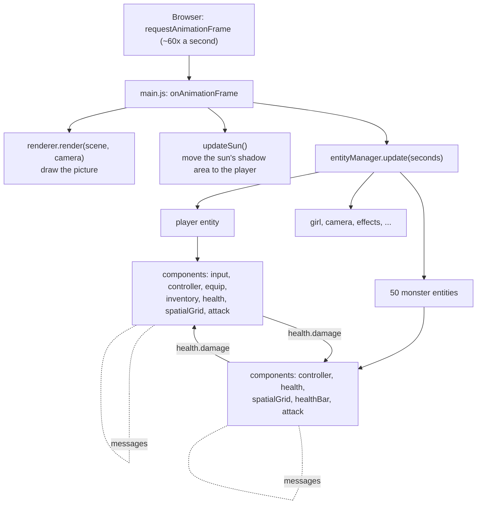
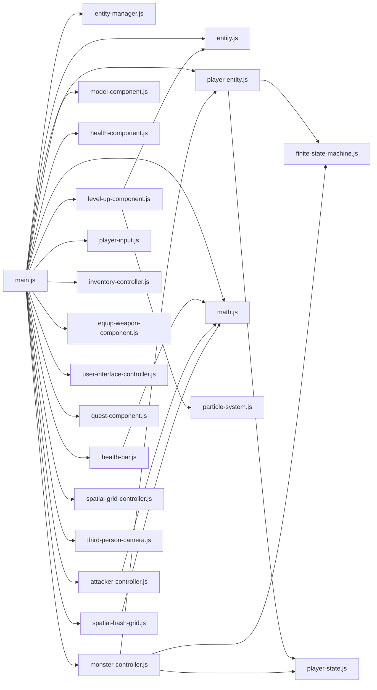

# 3. Architecture

This chapter explains **how the code is organised**. The big idea is called
**entity–component**, and it is used by most game engines (Unity, Unreal, Godot all have a version of it).

---

## 3.1 The problem it solves

The game has a knight, 50 monsters, a girl, 100 trees, 20 clouds, a camera and a sword.
They share *some* abilities but not others:

| | has a 3D model | has health | can attack | is in the grid | can be clicked |
|---|:-:|:-:|:-:|:-:|:-:|
| Knight (player) | ✔ | ✔ | ✔ | ✔ | |
| Monster | ✔ | ✔ | ✔ | ✔ | |
| Girl | ✔ | | | ✔ | ✔ |
| Tree | ✔ | | | ✔ | |
| Cloud | ✔ | | | | |
| Sword (item) | | | | | |

Instead of writing a big "Knight" program and a big "Monster" program that copy each other,
every ability is written **once**, as a small piece (a **component**), and each thing in the
world (an **entity**) is assembled from the pieces it needs — like building with LEGO.

## 3.2 Entity — a container

An **entity** (`src/entity.js`) is a plain object with:

| Property / function | Meaning |
|---------------------|---------|
| `name` | Unique name, e.g. `'player'`. Unnamed entities get an automatic one like `'__name__7'`. |
| `position`, `rotation` | Where it is and which way it faces. |
| `components` | Its abilities, stored by `type` (e.g. `components.health`). |
| `addComponent(component)` / `getComponent(type)` | Add an ability / fetch one. |
| `on(topic, handler)` / `broadcast(message)` | Its message system (see 2.4). |
| `setPosition(position)` | Move it **and** announce `'update.position'` so its components can follow. |
| `findEntity(name)` | Look up another entity, e.g. `'player'`. |
| `update(secondsElapsed)` | Called every frame; just calls `update` on each component. |

An entity does almost nothing by itself. All behaviour lives in components.

## 3.3 Component — one ability

A **component** is also a plain object. It has:

- a `type` — its name inside the entity, like `'health'` or `'spatialGrid'`;
- optionally `init(entity)` — called once when it is added to an entity;
- optionally `update(secondsElapsed)` — called every frame;
- any extra functions it wants to offer others (for example `isAlive()` on the health component).

Every component is made by a **factory function** — an ordinary function that builds and returns the object.
Private data lives in local variables inside the function (a **closure**: the inner functions remember
the variables of the function they were created in). For example, this is the whole shape of a component:

```js
export function HealthComponent(parameters) {
  let entity, health = parameters.health;        // private: nobody outside can touch these
  return {type: 'health', parameters, init, isAlive: () => health > 0};

  function init(owner) {
    entity = owner;
    owner.on('health.damage', onDamage);         // listen for damage messages
  }

  function onDamage({value}) {
    health = Math.max(0, health - value);
    // ...
  }
}
```

and it is used like this:

```js
const monster = Entity();
monster.addComponent(HealthComponent({health: 50, maxHealth: 50, /* ... */}));
monster.getComponent('health').isAlive();   // true
```

(The function definitions after `return` still work, because JavaScript "hoists" function declarations —
they exist from the start of the function.)

## 3.4 Messages — how components talk

Components on the same entity often need to react to each other, but they should not depend on each
other directly. So an entity has a tiny **publish / subscribe** system:

- `entity.on('health.damage', handler)` — "call me whenever a `health.damage` message arrives";
- `entity.broadcast({topic: 'health.damage', value: 30})` — "deliver this to everyone listening".

A message is just an object with a `topic` plus whatever data it needs.
All topics used in the game:

| Topic | Sent by | Received by | Meaning |
|-------|---------|-------------|---------|
| `update.position` | `entity.setPosition` | model components, grid controller, monster controller | "I moved; follow me." |
| `update.rotation` | `entity.setQuaternion` | (nobody yet) | "I turned." |
| `load.character` | player controller, animated model | equip weapon | "My 3D model and skeleton are ready." |
| `load.weapon` | equip weapon | (nobody yet) | "My weapon model is ready." |
| `player.action` | player / monster controller | attack controller | "My current animation is *attack* and it is at 0.43 s." |
| `health.damage` | attack controller (of the attacker) | health (of the victim) | "You take 150 damage, from me." |
| `health.update` | health | health bar | "My health is now 20 of 50." |
| `health.death` | health | player / monster controller | "I just died — play the death animation." |
| `health.add-experience` | health (of the victim) | health (of the killer) | "You earned 100 experience points." |
| `health.levelGained` | health | (nobody yet) | "I reached a new level." |
| `inventory.add` | `main.js` | inventory | "Put this item into an empty backpack slot." |
| `inventory.equip` | `main.js`, inventory | equip weapon | "Hold this item in your hand." |
| `input.picked` | player input | quest | "The mouse clicked on you." |

Note that messages can go to **another** entity too: the attacker calls `target.broadcast(...)` on the
monster it hit.

## 3.5 The entity manager — the list of everything

`src/entity-manager.js` keeps every entity in a list and in a name lookup table.

- `add(entity, name)` — register an entity (and give it a name).
- `get(name)` — find one by name (`'player'`, `'user-interface'`, `'level-up-spawner'`, `'player-camera'`).
- `filter(test)` — find all entities passing a test (used to find clickable things).
- `setActive(entity, false)` — stop updating it every frame. Trees and clouds never change, so they are
  switched off straight after creation to save work. They are still drawn, because drawing is done by the
  three.js scene, not by the entity manager.
- `update(secondsElapsed)` — update every active entity. Called once per frame.

## 3.6 The big picture



## 3.7 What each entity is made of

| Entity (name) | Components (type → factory function) |
|---------------|--------------------------------------|
| `user-interface` | `userInterface` → `UserInterfaceController` |
| `level-up-spawner` | `levelUpSpawner` → `LevelUpComponentSpawner` |
| axe, sword (automatic names) | `item` → `InventoryItem` |
| girl | `animatedModel` → `AnimatedModelComponent`, `spatialGrid` → `SpatialGridController`, `pickable` → `PickableComponent`, `quest` → `QuestComponent` |
| `player` | `input` → `BasicCharacterControllerInput`, `controller` → `BasicCharacterController`, `equip` → `EquipWeapon`, `inventory` → `InventoryController`, `health` → `HealthComponent`, `spatialGrid` → `SpatialGridController`, `attack` → `AttackController` |
| `player-camera` | `camera` → `ThirdPersonCamera` |
| 50 monsters | `controller` → `MonsterController`, `health` → `HealthComponent`, `spatialGrid` → `SpatialGridController`, `healthBar` → `HealthBar`, `attack` → `AttackController` |
| 100 trees | `staticModel` → `StaticModelComponent`, `spatialGrid` → `SpatialGridController` (inactive) |
| 20 clouds | `staticModel` → `StaticModelComponent` (inactive) |
| level-up effect (created on level up) | `levelUp` → `LevelUpComponent` |

Notice the player and monsters share `health`, `spatialGrid` and `attack`. Only the `controller`
differs: the player's reads the keyboard, the monster's decides by itself.

## 3.8 Start-up sequence

When the page has loaded, `HackAndSlashGame()` in `src/main.js` runs once:

1. Create the **renderer** and put its `<canvas>` into the page.
2. Create the **camera**, the **scene** (with white background and blue fog), the **sun** (a directional
   light that casts shadows) and the green **ground** plane.
3. Create the **entity manager** and the **spatial hash grid** (2000 × 2000 units, 100 × 100 cells).
4. Create the entities in this order: user interface → level-up spawner, axe, sword, girl, player, camera,
   50 monsters → 100 trees → 20 clouds → the sky (a giant sphere plus a hemisphere light).
5. Give the player the axe and sword (`inventory.add`) and equip the sword (`inventory.equip`).
6. Start the game loop.

Loading 3D model files takes time, so the models appear a moment later. Every component that loads a model
simply does nothing in `update` until its model has arrived.

## 3.9 Dependencies between files



All 3D files also import **three.js** (`THREE`) from the internet.
