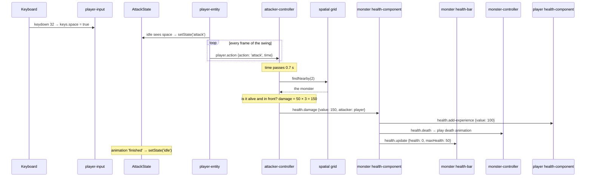

# 5. Walkthroughs

Step-by-step stories of what the code does when something happens in the game.
Follow along in the files named in **bold**.

---

## 4.1 You press W

1. The browser fires a `keydown` event with key code 87.
   **`player-input.js`** → `setKey` sets `keys.forward = true`.
2. Next frame, **`main.js`** `onAnimationFrame` → `entityManager.update` → player entity `update` →
   **`player-entity.js`** `update`.
3. `stateMachine.update(...)` → the current state is `IdleState` (**`player-state.js`**), which sees
   `keys.forward` and calls `stateMachine.setState('walk')`.
4. **`finite-state-machine.js`** builds a `WalkState` and calls `enter(previousState)`, which cross-fades
   the idle animation into the walk animation over 0.1 seconds.
5. Back in the controller: `velocity.z` increases by 50 × seconds. `nextPosition` works out the new spot
   one small step ahead.
6. `collides` asks the grid for neighbours within 5 units. Nothing within 4 units → move.
7. `entity.setPosition(position)` broadcasts `update.position`:
   - **`spatial-grid-controller.js`** updates the player's cell in the grid.
8. **`third-person-camera.js`** (its own entity, updated in the same loop) sees the player's new position
   and glides after it.
9. **`main.js`** `updateSun` moves the shadow area to follow, and `renderer.render` draws the picture.

When you release W, `keys.forward` becomes false, `WalkState.update` switches to idle, and friction
(`applyDeceleration`) slows the knight down.

## 4.2 You press Space next to a monster

1. Space sets `keys.space`. `IdleState` switches to `AttackState`, which plays the slash animation once.
2. Every frame, **`player-entity.js`** `broadcastAction` sends `player.action` with the animation time.
3. **`attacker-controller.js`** waits for the time to cross 0.7 s, then finds monsters within 2 units that
   are in front of the knight and sends each `health.damage` with 150 damage.
4. The monster's **`health-component.js`** drops to 0 → tells the player `health.add-experience`, and
   broadcasts `health.death` (its **`monster-controller.js`** switches to the death animation) and
   `health.update` (its **`health-bar.js`** slides to empty and red).
5. When the slash animation ends, the three.js mixer fires `finished`; `AttackState` goes back to idle.

A dead monster's health is 0, so `collides` ignores it (you can walk through the body) and the attack
code ignores it too.

## 4.3 A monster attacks you

The same code, the other way around. Each frame **`monster-controller.js`** `walkTowardPlayer`:

1. Finds the living `player` within 100 units. If there is none, it stays idle.
2. Pretends to hold W, turns to face the player and walks.
3. When the next step would come within 4 units of the player, it pretends to press Space instead.
4. `IdleState` sees Space → `AttackState` → bite animation → at 0.35 s **`attacker-controller.js`** sends the
   player 2 damage → the player's health bar at the top left shrinks.

At 0 health the player gets `health.death` → death animation, and monsters stop chasing (they only chase
a *living* player).

## 4.4 You level up

1. You kill your first monster: +100 experience. Level 1 needs 100 → level up.
2. **`health-component.js`** raises strength, wisdomness, benchpress (+1) and curl (+2), and updates the
   statistics panel.
3. It finds the `level-up-spawner` entity and calls `spawn(player position)`.
4. **`level-up-component.js`** creates a new entity with a `LevelUpComponent` → 300 particles.
5. **`particle-system.js`** animates them for up to 3 seconds; when all have died the effect entity
   turns itself off.
6. The next level needs 200 more points, then 400, and so on.

## 4.5 You click the girl

1. The browser fires `mouseup`. **`player-input.js`** `onMouseUp` hides the quest box, converts the mouse
   position, and shoots a ray from the camera.
2. It looks at entities with a `pickable` component and a loaded model — only the girl.
3. If the ray passes through the box around her model, she gets `input.picked`.
4. Her **`quest-component.js`** finds the `user-interface` entity and calls `addQuest`.
5. **`user-interface-controller.js`** adds "Welcome Adventurer!" to the journal (only the first time) and
   shows the quest text box.

## 4.6 You drag the axe into an equipment slot

1. At the start, **`main.js`** sent `inventory.add` for the axe and the sword, so they are in backpack
   slots 1 and 2, and `inventory.equip` for the sword, so the knight holds the sword.
2. You open the inventory (backpack icon) and drag the axe. `ondragstart` remembers `inventory-1`.
3. You drop it on an equipment slot: `ondrop` → `onItemDropped` swaps the two slots' contents and icons.
4. Because the target is an equipment slot, `inventory.equip` is broadcast with the axe's name.
5. **`equip-weapon-component.js`** removes the sword model, loads `Axe.fbx`, and attaches it to the hand bone.
6. From now on **`attacker-controller.js`** uses the axe's `damage` value.
